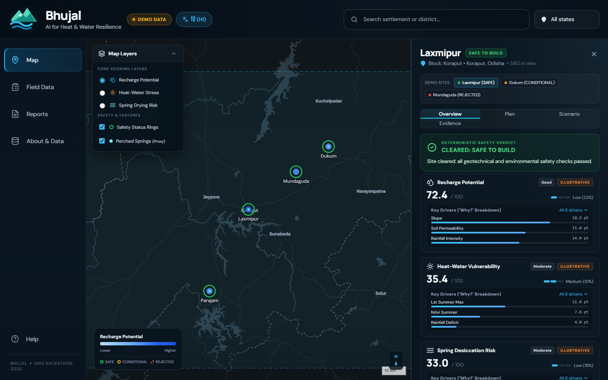
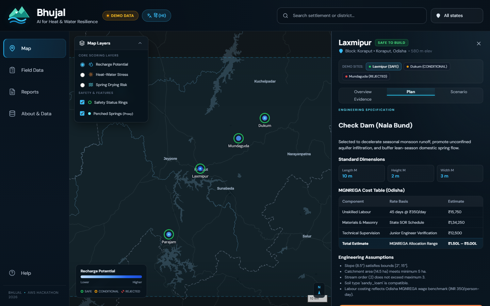
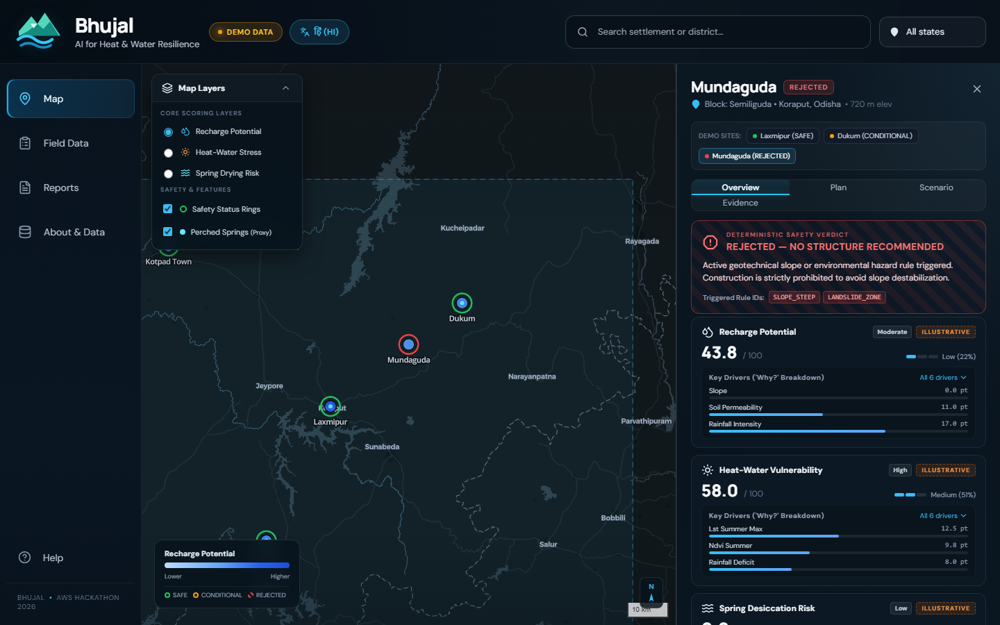
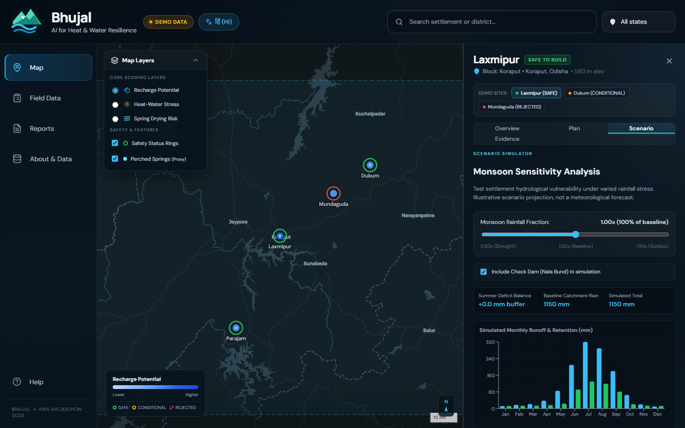
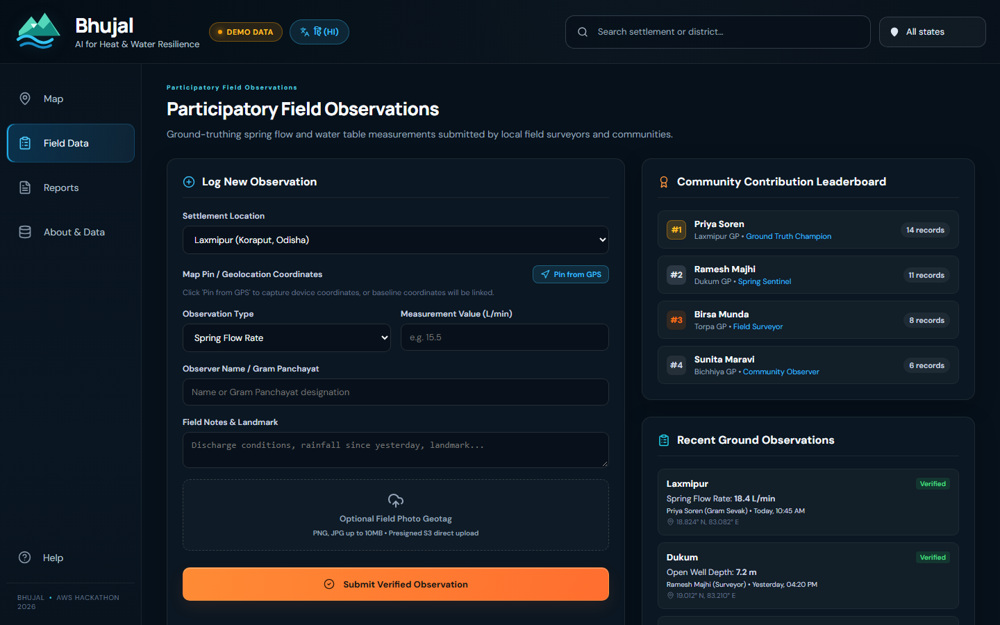
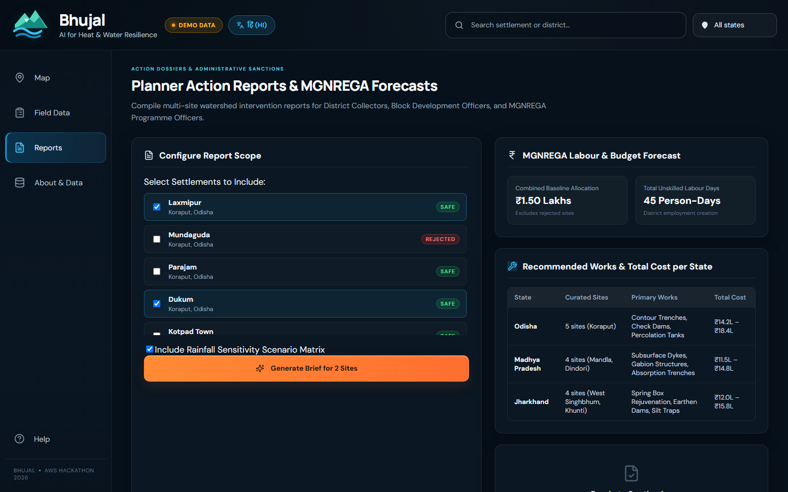
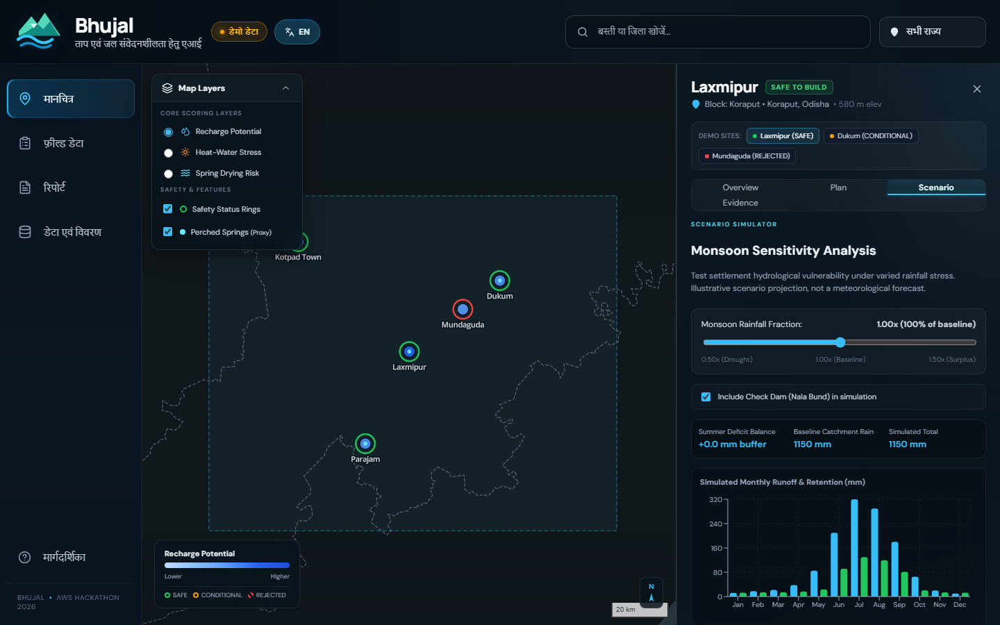
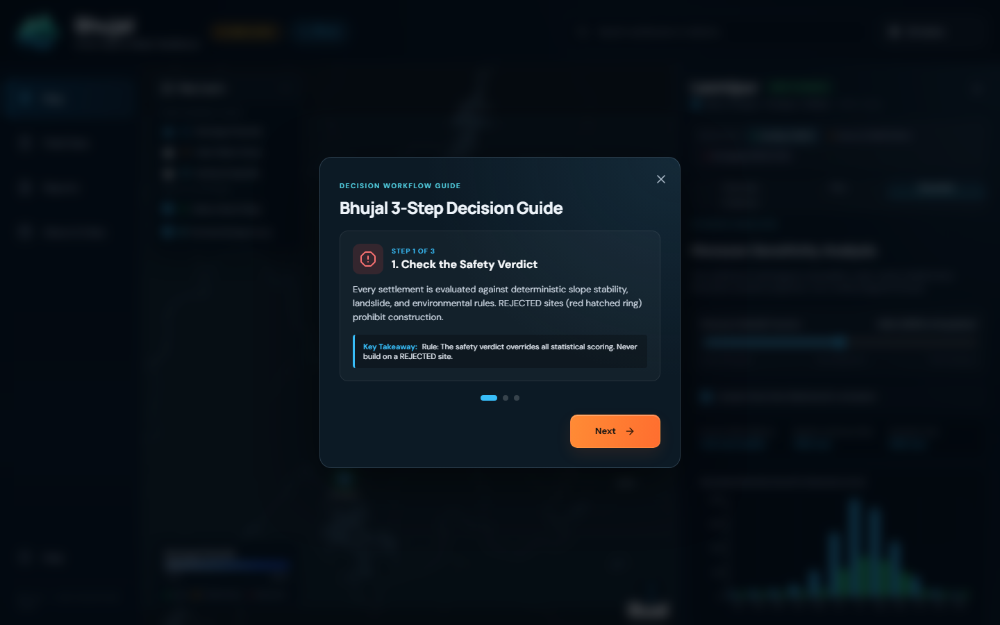
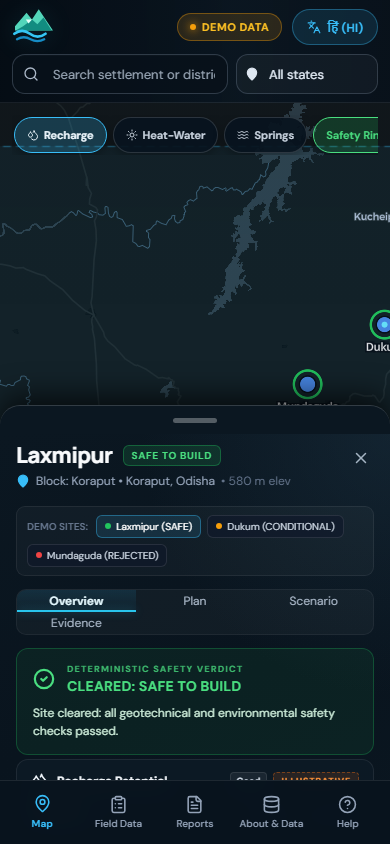
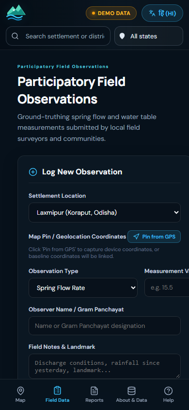

# Bhujal (भूजल) — AI for Heat & Water Resilience

> **Amazon Environmental Hacks 2026 — Heat & Water Track**  
> *A transparent, site-level decision support system for climate adaptation, artificial groundwater recharge, and MGNREGA works sanctioning across tribal settlements in Odisha, Madhya Pradesh, and Jharkhand.*

---

## 🌟 Executive Overview

In climate-vulnerable tribal plateaus of central and eastern India, decision-makers are frequently forced to choose between abstract satellite rasters and unverified guesswork. **Bhujal** bridges this gap by providing an honest, site-level spatial decision support tool deployed on **AWS** (Amplify Hosting, Lambda, API Gateway, S3, DynamoDB) that connects empirical groundwater telemetry (CGWB), climate extremes (IMD), and geotechnical safety rules directly to sanctioned MGNREGA public works.

### Key Differentiators

1. **Deterministic Geotechnical Safety Override**:
   - Statistical AI scores and LLM recommendations are strictly subordinated to deterministic engineering safety rules.
   - If a settlement violates slope stability, landslide hazard, or fractured scarp rules (e.g. `SLOPE_STEEP`), it receives a **`REJECTED`** verdict. The UI immediately displays a prominent hatched red warning and **strictly withholds all structural build recommendations** to avoid fatal slope destabilization.
2. **Honest Site-Level Data Binding (No Fake Rasters)**:
   - Features 13 curated settlements across Koraput (Odisha), Mandla/Dindori (MP), and West Singhbhum/Khunti (Jharkhand).
   - Muted Carto Dark Matter vector basemap with sequential color ramps, priority sizing, and safety status rings.
3. **Transparent 'Why?' Driver Breakdown**:
   - Every composite score (Recharge Potential, Heat-Water Stress, Spring Desiccation Risk) decomposes into factor contribution bars showing exact weights and data provenance.
4. **State-Calibrated MGNREGA DPR Generation**:
   - Work plans use authentic 2025–26 state wage rates: **Odisha ₹350/day**, **Madhya Pradesh ₹243/day**, **Jharkhand ₹255/day**.
   - One-click export of official Detailed Project Report (**DPR .ZIP**) packages with engineering drawings and environmental checklists.
5. **Monsoon Scenario Simulator**:
   - Test settlement hydrological vulnerability under varied rainfall stress (`0.50x` drought to `1.50x` surplus) with real-time summer water deficit readouts and monthly water balance charts.
6. **Participatory Ground-Truthing**:
   - Community observers log verified spring discharge and water table depths with **browser GPS map pinning** and **AWS S3 presigned URL photo uploads**.
7. **Bilingual Localization & Universal Accessibility**:
   - Instant toggle between **English** and **Hindi (हिन्दी)**.
   - Mobile-first responsive design down to **390×844 viewport** featuring bottom sheets, horizontal layer chips, and bottom tab navigation.
   - Tested for zero dead controls, keyboard navigation, and high-contrast readability.

---

## 📸 Interface & Workflow Gallery

### 1. Spatial Decision Map & Cleared Site Overview

*MapLibre vector basemap displaying 13 curated settlements with status rings, collapsible layer controls, dynamic legend, and the Overview tab for Laxmipur (`SAFE`).*

---

### 2. MGNREGA Work Plan & DPR Generation

*Plan tab for Laxmipur detailing standard structure dimensions, state wage rate calculations (Odisha ₹350/day), engineering assumptions, and one-click DPR ZIP package compilation.*

---

### 3. Deterministic Safety Override (REJECTED Site)

*Mundaguda triggers rule `SLOPE_STEEP`. The UI strictly overrides scores, displays a red hatched safety banner above the fold, and locks DPR generation.*

---

### 4. Monsoon Sensitivity Scenario Simulator

*Interactive rainfall sensitivity slider (`0.50x` to `1.50x`), intervention toggle, simulated monthly water balance chart (Recharts), and summer deficit readout.*

---

### 5. Participatory Field Data & GPS Pinning

*Ground observation logging form with device GPS geolocation map pinning, S3 presigned URL photo geotagging, community leaderboard, and verified history.*

---

### 6. Multi-Site Reports & State-Wise Budget Forecast

*Multi-settlement scope selector, combined MGNREGA baseline budget forecast, and State-wise recommended works comparison table.*

---

### 7. Bilingual Hindi (हिन्दी) Localization

*Complete bilingual UI localization. All UI strings and narratives translate seamlessly while coordinates, numbers, and rule IDs remain untouched.*

---

### 8. First-Run Decision Workflow Guide

*Accessible 3-step decision workflow guide accessible via 'Help', explaining safety rules, driver breakdowns, and DPR exports.*

---

### 9. Mobile Responsive Experience (390×844 Viewport)
<div align="center">
  
  &nbsp;&nbsp;&nbsp;&nbsp;
  
</div>
*Left: Mobile Map view with compacted header, horizontal layer chips, and draggable bottom sheet (`peek`, `half`, `full`). Right: Mobile Participatory Field Data screen with bottom navigation tab bar.*

---

## 🏗️ Architecture & AWS Services

```
┌────────────────────────────────────────────────────────────────────────┐
│                          Bhujal Architecture                           │
└────────────────────────────────────────────────────────────────────────┘
                                    │
               ┌────────────────────┴────────────────────┐
               ▼                                         ▼
   Frontend (AWS Amplify)                   Backend (AWS Serverless)
   • React 18 (Pure JavaScript)             • FastAPI on AWS Lambda
   • MapLibre GL v5 (Vector)                • Amazon API Gateway
   • Recharts (Water balance)               • Amazon S3 (DPR / Photos)
   • Responsive (Desktop + 390x844)         • Amazon DynamoDB (Field Obs)
```

| AWS Service | Role in Bhujal |
| :--- | :--- |
| **AWS Amplify Hosting** | Continuous deployment of the React single-page application with edge CDN distribution. |
| **AWS Lambda + API Gateway** | Serverless REST API endpoints for `/villages`, `/sites/{id}`, `/scenario`, and `/dpr/generate`. |
| **Amazon S3** | Secure storage for generated DPR ZIP packages and presigned URL field photo uploads. |
| **Amazon DynamoDB** | Low-latency storage of crowd-sourced participatory field observations and telemetry logs. |

---

## 🧪 Automated QA & Smoke Testing

Bhujal includes a Playwright end-to-end smoke test suite verifying all critical decision paths and mobile responsiveness:

```bash
# Run Playwright end-to-end smoke tests
npm test
```

### Test Coverage Summary:
- **Test 1**: Assert `REJECTED` demo site displays red safety override above the fold and conceals build recommendations.
- **Test 2**: Assert `SAFE` site displays cleared safety verdict and compiles a DPR package.
- **Test 3**: Assert moving the rainfall slider dynamically recalculates the summer deficit readout.
- **Test 4**: Assert language toggle translates UI strings to Hindi while keeping numbers and rule IDs untranslated.
- **Test 5**: Assert multi-view navigation functions cleanly with **zero console errors** on both **Desktop** and **Mobile 390×844**.

All **10 tests passed cleanly in < 10 seconds**.

---

## 🚀 Running Locally

### Prerequisites
- Node.js 18+
- npm 9+

### Quick Start
```bash
# 1. Navigate to the frontend directory
cd frontend

# 2. Install dependencies
npm install

# 3. Start local development server
npm run dev
```

Visit `http://localhost:5173` in your browser.

### Environment Configuration
The frontend automatically runs in offline mock mode using curated empirical data for the 13 settlements. To point to a live AWS backend:
```env
VITE_API_URL=https://your-api-id.execute-api.ap-south-1.amazonaws.com/prod
VITE_USE_MOCK=false
```

---

## 📜 Architectural Decisions Log
Detailed logs of all design trade-offs and architectural decisions are maintained in [docs/DECISIONS.md](docs/DECISIONS.md).
